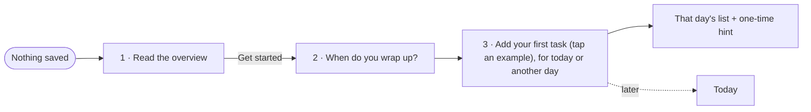
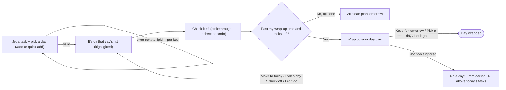
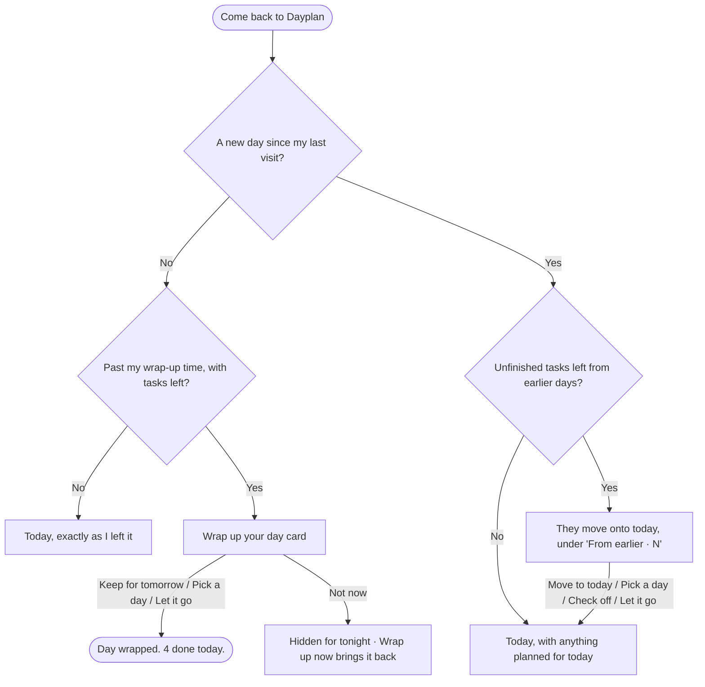

# Dayplan

A personal to-do list where every task belongs to a day. You add tasks to today or any day ahead and check them off. Each evening, at a wrap-up time you choose, Dayplan asks what to do with anything left. Whatever you skip waits under **From earlier** the next day, so nothing gets lost.

Built for Design, Build, Ship (MPCS 51238), Assignment 3: Patterns & Flows. It's built with Next.js and Tailwind CSS, and everything is saved in the browser with localStorage, with no accounts or database.

- **Live app:** _not deployed yet, so the Vercel URL goes here_
- **More detail:** [flows.md](flows.md) has each flow's steps, states, and errors. [ACCESSIBILITY.md](ACCESSIBILITY.md) has the Step 7 check.

## Flows

### First visit

> **I open Dayplan with nothing saved → I read what it's for → I set when I'm usually done for the day → I add my first task by tapping an example, for today or another day → I land on Today (or At a Glance, for a later day), with a one-time hint on how it works.**

### Main task

> **I jot a task for a certain day → it's on that day's list → I check it off → at my wrap-up time, I keep or push what's left; if I don't, it carries into tomorrow under "From earlier."**

### Coming back

> **I come back in the evening → at my wrap-up time Dayplan asks what to do with what's left → I keep it for tomorrow, move it, or let it go → if I skip that, tomorrow it's waiting under "From earlier."**

## First-run check (Step 8)

_Not run yet._ Once the app is live on Vercel, an agent will use it as a brand-new user, with a goal like "Add three things you need this week," then come back later. Its usability feedback, and what I changed because of it, will go here.
