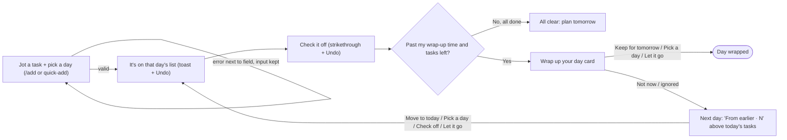

# hw3-dbs: A Day-by-Day To-Do List

A personal to-do list where every task belongs to a day. Add a task for any day, then check it off. At a wrap-up time you choose, decide what to do with whatever's left. Anything you don't deal with carries forward, so nothing gets lost.

Built for Design, Build, Ship (MPCS 51238), Assignment 3: Patterns & Flows.

**Stack:** Next.js and Tailwind CSS. Data is saved in the browser with localStorage, with no database, accounts, or outside services. Deployed on Vercel's Hobby plan.

---

## Flows

### Main task

> **I jot a task for a certain day → it's on that day's list → I check it off → at my wrap-up time, I keep or push what's left; if I don't, it carries into tomorrow under "From earlier."**

### Steps

Each arrow in the sentence is a step, and each step has its own page (route) with shared navigation: **Today · Upcoming · Done**, plus a **+ Add** button.

| # | Step | Page |
|---|---|---|
| 1 | Jot a task for a day | `/add` (or quick-add on `/`) |
| 2 | It's on that day's list | `/` for today, `/day/[date]` for other days |
| 3 | Check it off | the same list |
| 4 | Wrap up: keep for tomorrow, pick a day, or let it go | `/` after your wrap-up time |
| 5 | Otherwise, carry forward into **From earlier · N** | `/` the next day |

### What I kept from planning with the agent

I worked out this flow with my agent in plan mode. Along the way I made these choices:

- **Every task belongs to a day,** not just "today" or "someday." I can plan Thursday's dentist call on Monday.
- **A nightly check-in at a time I choose.** This is the reason to come back each evening.
- **Leftovers pile up instead of disappearing.** If I skip the wrap-up, unfinished tasks show up in a separate "From earlier" section, and they stay there until I deal with them.
- **A warning when a task is too similar to one already on that day** (e.g. "Calll mom" when "Call Mom" exists). It's a soft warning: pressing Add again keeps both.
- **Undo instead of confirmation dialogs** for adding, checking off, and deleting tasks.
- **Not included, to keep it simple:** projects, tags, priorities, and recurring tasks.

The full list of steps, states, and errors is in [flows.md](flows.md).
