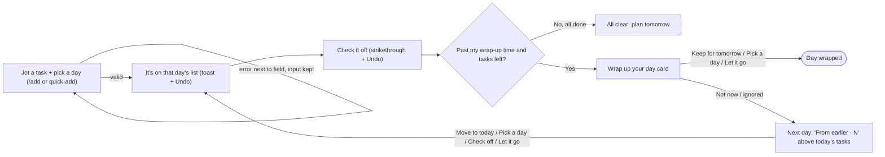
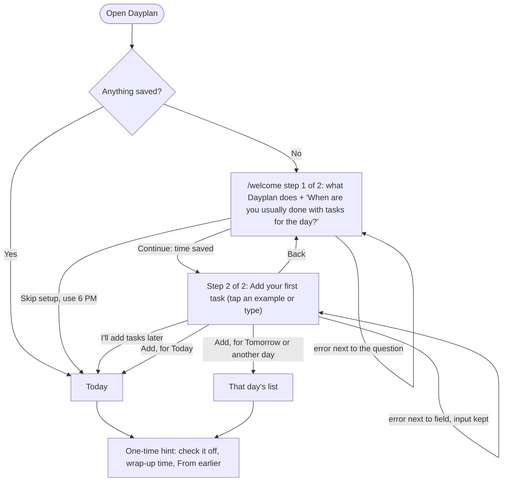

# Flows

## Main task (one sentence)

> **I jot a task for a certain day → it's on that day's list → I check it off → at my wrap-up time, I keep or push what's left; if I don't, it carries into tomorrow under "From earlier."**

---

## Steps (each arrow above, one page per step)

| # | Step | Page | What happens |
|---|---|---|---|
| 1 | **Jot a task for a day** | `/add` (plus quick-add on `/`) | The form has **Task** (required) and **Day** (required). Day has quick buttons for Today and Tomorrow, plus a **Pick a day** date input. Today is the default. Quick-add on `/` skips the form and puts the task on today. |
| 2 | **It's on that day's list** | `/` for today, `/day/[date]` for other days | After saving, the app goes to that day's list. The new task is highlighted, and a toast says *"Added 'Dentist call' to Thu, Oct 23"* with an **Undo** button. |
| 3 | **Check it off** | the same list | Tapping the circle (or pressing Space on it) strikes the task through and moves it below unfinished tasks. A toast says *"1 done today"* with Undo. |
| 4 | **Wrap up: keep or push** | `/` | After your wrap-up time, a **Wrap up your day** card lists what's left. Each task has **Keep for tomorrow**, **Pick a day**, and **Let it go** buttons. **Move all to tomorrow** handles everything at once, and **Not now** hides the card for tonight. |
| 5 | **Otherwise, carry forward** | `/` the next day | Unfinished tasks from past days appear in a **From earlier · N** section above today's tasks, each with its age (*"from Mon"*). They keep piling up until you check them off, move them to today, pick a day, or let them go. |

**Shared nav:** `Today · Upcoming · Done` plus a **+ Add** button. Each page heading names its day, e.g. "Today · Sun, Oct 19".

---

## States (only those this flow touches)

| Step | State | What shows |
|---|---|---|
| any | **Loading** (saved data not read yet) | A skeleton list, so the page never flashes "empty" before data loads. |
| 1 | **Form ready** | Task box focused, Day set to Today (or pre-filled from `/add?date=…`). |
| 1 | **Form with errors** | Errors below their fields, what you typed kept, cursor on the first bad field. |
| 1 | **Form submitting** | The button is briefly disabled so a double-click can't add the task twice. |
| 2 | **Just added** | The new task is highlighted and the Undo toast is showing. |
| 2 | **Day with tasks** | Unfinished tasks first, finished ones struck through below. |
| 2 | **Empty day** | *"Nothing planned for Thu, Oct 23."* with an **Add a task for this day** button. |
| 3 | **Just checked** | Strikethrough plus an Undo toast. |
| 3 | **All done for the day** | *"All clear for today."* with **Plan tomorrow** and **See upcoming** buttons. Not a dead end. |
| 4 | **Before wrap-up time** | A normal list, with "Wrap-up at 7 PM every day · **Edit**" in the header. Edit opens the same time question as onboarding. There is one wrap-up time for all days, so changing it affects every day. |
| 4 | **Wrap-up due** | The Wrap up your day card at the top of the list. |
| 4 | **Wrap-up dismissed** | No card tonight. Tasks are unchanged. |
| 4 | **Day wrapped** | *"Day wrapped. 4 done today."* |
| 5 | **From earlier present** | A separate section with a count, each task's age, and **Move all to today** / **Clear all** buttons (with Undo). |
| 5 | **Only "From earlier" tasks** | That section plus quick-add for today. |

---

## Errors (next to the field, saying what to do next, keeping what you typed)

| Step | Trigger | Message |
|---|---|---|
| 1 | Empty or whitespace-only task | **"Enter a task name."** |
| 1 | Task longer than 120 characters | **"Shorten this to 120 characters or fewer (now 134)."** |
| 1 | No day chosen, or the date can't be read | **"Pick a day for this task."** |
| 1 | A past date | **"Pick today or a later day."** |
| 1 | The same unfinished task already on that day | **"'Laundry' is already on Thu, Oct 23. Add it anyway?"** This is a soft warning: submitting again adds it. |
| 1 | A task very similar to an unfinished one on that day (e.g. "call mom" vs. "Call Mom!" or "Calll mom") | **"This looks like 'Call Mom', already on Thu, Oct 23. Change the name, or press Add again to keep both."** The existing task is shown with an **Edit that one instead** link. This is a soft warning: what you typed is kept, and a second submit adds it. |
| 2 | Bad date in the address (`/day/abc`) | **"That's not a date we recognize."** with a link back to Today. |
| 2–5 | Accidental add, check, delete, or let go | A toast with **Undo**. This is prevention rather than a confirmation dialog. |
| 4 | Pick a day set to a past date | **"Pick today or a later day."** shown inline on that task's row. |
| any | The browser can't save | Banner: **"This browser isn't saving. Tasks will disappear when you close the tab."** |
| any | Storage is full | Banner: **"Storage is full. Clear finished tasks on the Done page to keep saving."** |
| any | Saved data can't be read | Banner: **"We couldn't read your saved tasks, so we started a fresh list."** The old data is backed up first. |

**How "too similar" is decided** (a small helper function, no package):
1. Both names are cleaned up first: lowercased, trimmed, repeated spaces collapsed, punctuation removed, and a trailing "s" dropped.
2. The new task counts as similar if, after cleanup, any of these is true:
   - the two names are **identical**
   - one name **contains** the other, and the shorter one is at least 4 characters
   - the names differ by **2 or fewer letters** (edit distance), and both are at least 5 characters long
3. Only **unfinished** tasks on the **same day** are compared.
4. Typing an exact duplicate shows the "already on" message. Anything else that counts as similar shows the "looks like" message.

For accessibility, each error is linked to its field with `aria-invalid` and `aria-describedby`, and the error text sits in an `aria-live="polite"` region.

---

## Diagram (main task)

---

## First visit (onboarding)

> **I open Dayplan with nothing saved → it tells me what it's for and asks when I'm usually done for the day → I add my first task by tapping an example, for today or another day → I land on that day's list, with a one-time hint on how it works.**

| Step | Page | What happens |
|---|---|---|
| 1. Say what it is and ask the one question | `/welcome` | The headline is **"Plan your tasks day by day."** Below it are three numbered lines: add tasks to any day, check them off, and keep or move what's left at the end of the day. Then comes the line *"Saved on this device. No account needed."* The question is **"When are you usually done with tasks for the day?"**, with 5–9 PM chips or **Other time**. |
| 2. Add a first task by example | `/welcome` (same page, step 2) | Example chips (**+ Reply to emails**, **+ Do laundry**, …) fill in the Task field. The Day field offers Today, Tomorrow, or Pick a day, with the note *"Nothing for today? Choose Tomorrow or pick another day."* |
| 3. Land on the list | `/` or `/day/[date]` | The new task is highlighted and a toast appears with Undo. A **"You're set up"** hint explains checking off, the wrap-up time, and From earlier. It goes away after the first check-off or **Got it**. |

**States**

| State | What shows |
|---|---|
| Nothing saved | Opening `/` sends you to `/welcome`, with a skeleton while it loads (never an empty list). The app name and navigation bar stay hidden until onboarding is finished, so the only choices are the welcome steps. |
| Wrap-up time answered, then reload | It picks up again at step 2, because the time saves the moment you answer. |
| Skipped setup | The wrap-up time is 6 PM and you land on Today's empty state: *"Nothing on today's list yet."* |
| First task added late in the evening | The hint shows first. The wrap-up card waits until you dismiss the hint. |
| Opening `/welcome` again later | It works as a way to redo setup, with your saved time already chosen. |

**Errors**

| Trigger | Message |
|---|---|
| Pressing Continue with no time chosen | **"Pick the time you usually finish for the day."** |
| Choosing Other time and leaving it empty | **"Enter a time, like 7:00 PM."** |
| A morning time (before 12 PM) | **"9 AM is in the morning. If that's when you finish for the day, press Continue again."** This is a soft warning. |
| An empty first task | **"Enter a task name."** The day you picked is kept. |
| A past date chosen with Pick a day | **"Pick today or a later day."** |

## Human-error audit

I went through every flow looking for mistakes a person could make, then checked that each one gets a clear response.

| Mistake | What happens now |
|---|---|
| Typo in a task name, or a task added to the wrong day | Every task has **Edit**: rename it, change its day, or **Delete task**. Each one has Undo. Escape or Cancel closes without saving. |
| Mistyped year (2062 instead of 2026) | A soft warning: **"Thu, Oct 19, 2062 is more than a year away. Check the year, or press the button again to keep it."** It appears in Add, Edit, onboarding, and Pick a day. |
| Moving a task to the day it's already on | **"It's already on Thu, Oct 23. Pick a different day."** |
| Editing a From earlier task's name only | It keeps its past day, so there's no false "Pick today or a later day" error. |
| Pressing Enter twice after adding | The second Enter is ignored instead of showing "Enter a task name." |
| Accidentally checking or unchecking a task | Undo. When you uncheck a task, the message says where it went: *"It's back under From earlier on Today."* |
| Deleting one task | Undo stays up for 10 seconds instead of 6. It stays open while you hover over or focus it, and it can be dismissed with ✕. |
| Deleting many at once (**Clear all**, **Clear finished tasks**) | It asks first, inline: **"Delete all 5? Yes, delete / Cancel."** Then it gives a 10-second Undo. |
| Pressing **Not now** on the wrap-up by mistake | The message has Undo, and **Wrap up now** at the top of Today brings the card back. |
| Skipping onboarding with a task typed but not added | **"'Call Mom' isn't saved yet. Press Add to my list to keep it, or I'll add tasks later again to skip it."** |
| A morning wrap-up time (9 AM) | A soft warning. Pressing the button again keeps it. |

## Parked for later steps (not part of this answer)
- **Coming back (Step 6):** the streak and the `/done` history. (The wrap-up time can already be changed from **Edit** at the top of Today.)
