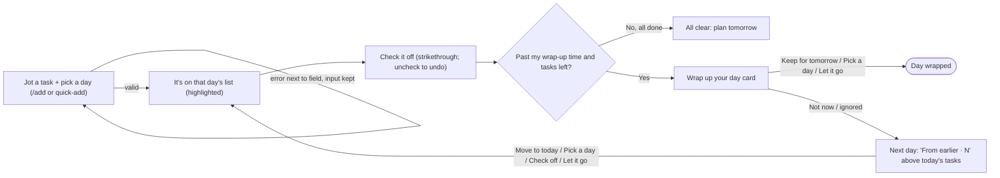
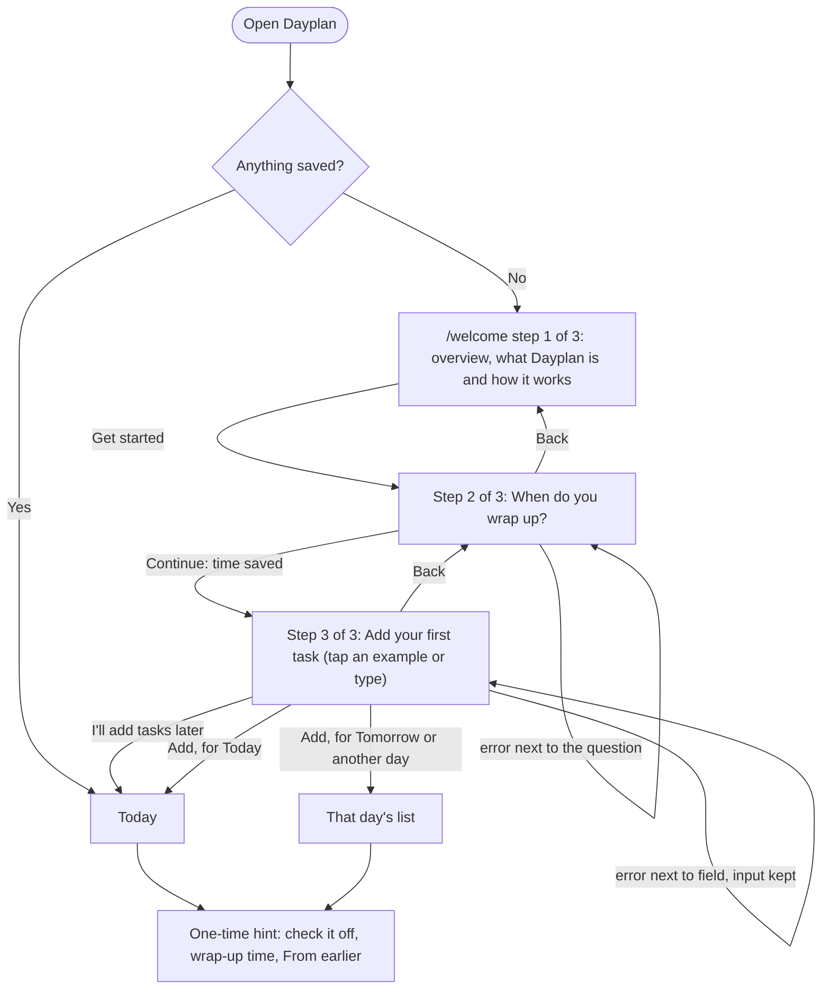
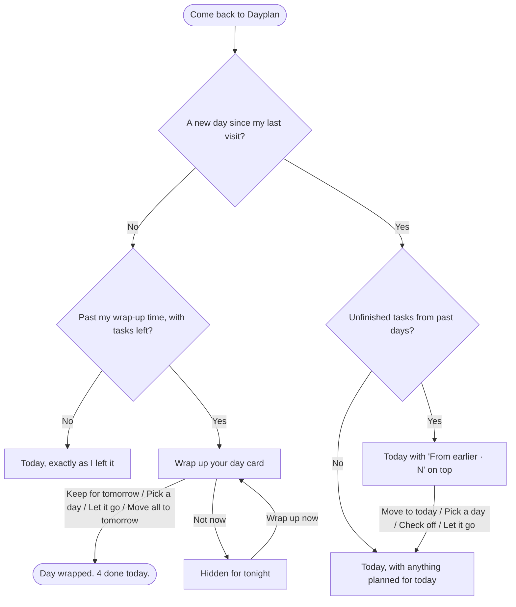

# Flows

Dayplan is built around three flows. Each one has a one-sentence summary and a diagram:

1. **[First visit](#first-visit-onboarding):** read the overview → set your wrap-up time → add your first task.
2. **[Main task](#main-task-one-sentence):** add a task for a day → it's on that day's list → check it off → wrap up what's left.
3. **[Coming back](#coming-back-it-remembers):** the wrap-up check-in at your time, and leftovers waiting under From earlier.

After those come the shared details: [Tab to complete](#tab-to-complete), [ordering and dragging](#ordering-and-dragging-today-at-a-glance-calendar), the [human-error audit](#human-error-audit), and the [design decisions](#design-decisions) behind it all.

## Main task (one sentence)

> **I jot a task for a certain day → it's on that day's list → I check it off → at my wrap-up time, I keep or push what's left; if I don't, it carries into tomorrow under "From earlier."**

---

## Steps (each arrow above, one page per step)

| # | Step | Page | What happens |
|---|---|---|---|
| 1 | **Jot a task for a day** | `/add` (plus quick-add on `/`) | The form has **Task** (required) and **Day** (required). Day has quick buttons for Today and Tomorrow, plus a **Pick a day** date input. Today is the default. Quick-add on `/` skips the form and puts the task on today. |
| 2 | **It's on that day's list** | `/` for today, `/glance` for any later day | A task for today lands you on **Today**. A task for a later day lands you on **At a Glance**, under its day. Either way the new task turns **light yellow for a few seconds**. If the list is long enough that the task landed off screen, the page scrolls to put it in the middle. Screen readers hear *"Added 'Dentist call' to Thu, Oct 23."* No message is needed, and **Edit → Delete task** removes it if it was a mistake. |
| 3 | **Check it off** | the same list | Checking the box (or pressing Space on it) strikes the task through and moves it below unfinished tasks. Unchecking reverses it, so there is no message. |
| 4 | **Wrap up: keep or push** | `/` | After your wrap-up time, a **Wrap up your day** card lists what's left. Each task has **Keep for tomorrow**, **Pick a day**, and **Let it go** buttons. **Move all to tomorrow** handles everything at once, and **Not now** hides the card for tonight. |
| 5 | **Otherwise, carry forward** | `/` the next day | Unfinished tasks from past days appear in a **From earlier · N** section above today's tasks, each with its age (*"from Mon"*). They keep piling up until you check them off, move them to today, pick a day, or let them go. |

**Shared nav:** `Today · At a Glance · Calendar · Done` plus a **+ Add task** button. Today's heading names the date, e.g. "Today · Sun, Oct 19", and every other page has its own heading.

---

## States (only those this flow touches)

| Step | State | What shows |
|---|---|---|
| any | **Loading** (saved data not read yet) | A skeleton list, so the page never flashes "empty" before data loads. |
| 1 | **Form ready** | Task box focused, Day set to Today (or pre-filled from `/add?date=…`). |
| 1 | **Form with errors** | Errors below their fields, what you typed kept, cursor on the first bad field. |
| 1 | **Double submit** | A second click or Enter right after adding is ignored, because the field is already empty. The button is never disabled. |
| 2 | **Just added** | The new task is light yellow for about 3 seconds, then fades back. With reduced motion, it stays yellow without fading. If it's off screen, the page scrolls it to the middle. |
| 2 | **Day with tasks** | Unfinished tasks first, finished ones struck through below. |
| 2 | **Empty day** | *"Nothing planned for Thu, Oct 23."* with an **Add a task for this day** button. |
| 3 | **Just checked** | Strikethrough. Uncheck to reverse. |
| 3 | **All done for the day** | *"All clear for today."* with **Plan tomorrow** and **See all tasks** buttons. Not a dead end. |
| 4 | **Before wrap-up time** | A normal list. A thin strip at the very top of every page reads *☾ Your day wraps up at 7 PM · Change*. **Change** opens the same time question as onboarding. There is one wrap-up time for all days, so changing it affects every day. |
| 4 | **Wrap-up due** | The Wrap up your day card at the top of the list. It appears at the wrap-up minute exactly: the clock ticks on each minute boundary and re-checks when you come back to the tab. |
| 4 | **Wrap-up dismissed** | No card tonight, and tasks are unchanged. A **Wrap up now** button under Today's heading brings the card back. |
| 4 | **Day wrapped** | *"Day wrapped. 4 done today."* |
| 5 | **From earlier present** | A separate section with a count, each task's age, and **Move all to today** / **Clear all** buttons (with Undo). |
| 5 | **Only "From earlier" tasks** | That section plus quick-add for today. |

---

## Errors (next to the field, saying what to do next, keeping what you typed)

| Step | Trigger | Message |
|---|---|---|
| 1 | Empty or whitespace-only task | **"Enter a task name."** |
| 1 | Task longer than 120 characters | **"Shorten this to 120 characters or fewer (now 134)."** |
| 1 | No day chosen, or the date can't be read | **"Pick a day for this task."** |
| 1 | A past date | **"Pick today or a later day."** |
| 1 | The same unfinished task already on that day | **"'Laundry' is already on Thu, Oct 23. To keep both, press Add again."** This is a soft warning: submitting again adds it. |
| 1 | A task very similar to an unfinished one on that day (e.g. "call mom" vs. "Call Mom!" or "Calll mom") | **"This looks like 'Call Mom', already on Thu, Oct 23. Change the name, or press Add again to keep both."** This is a soft warning: what you typed is kept, and a second submit adds it. |
| 2 | Bad date in the address (`/calendar?day=abc`) | The calendar opens on this month with today selected. A month before this one opens this month instead. |
| 2–5 | Accidental move, delete, or let go | A message at the bottom with **Undo**. An accidental add or check is reversed in place (Edit → Delete task, or uncheck), so it gets no message. |
| 4 | Pick a day set to a past date, or the day it's already on | **"Pick today or a later day."** or **"It's already on Thu, Oct 23. Pick a different day."** This shows in the date panel that opens under the task's buttons. The buttons stay together on one row, and the panel opens below them. |
| any | The browser can't save | Banner: **"This browser isn't saving. Tasks will disappear when you close the tab."** |
| any | Storage is full | Banner: **"Storage is full. Clear finished tasks on the Done page to keep saving."** |
| any | Saved data can't be read | Banner: **"We couldn't read your saved tasks, so we started a fresh list."** The old data is backed up first. |

**How "too similar" is decided** (a small helper function, no package):
1. Both names are cleaned up first: lowercased, trimmed, repeated spaces collapsed, punctuation removed, and a trailing "s" dropped.
2. The new task counts as similar if, after cleanup, any of these is true:
   - the two names are **identical**
   - one name **contains** the other, and the shorter one is at least 4 characters
   - the names differ by **2 or fewer letters** (edit distance), and both are at least 5 characters long
3. Only **unfinished** tasks on the **same day** are compared.
4. Typing an exact duplicate shows the "already on" message. Anything else that counts as similar shows the "looks like" message.

For accessibility, each error is linked to its field with `aria-invalid` and `aria-describedby`, and the error text sits in an `aria-live="polite"` region.

---

## Diagram (main task)

---

## First visit (onboarding)

> **I open Dayplan with nothing saved → I read what it's for → I set when I'm usually done for the day → I add my first task by tapping an example, for today or another day → I land on Today (or At a Glance, for a later day), with a one-time hint on how it works.**

| Step | Page | What happens |
|---|---|---|
| 1. Read the overview | `/welcome` | The page heading is **"Welcome to Dayplan"**, then *Step 1 of 3*. The card says **"Plan your tasks day by day."** with three numbered lines: add tasks to any day, check them off, and keep or move what's left at the end of the day. A note says *"Saved on this device. No account needed."* Then **Get started**. |
| 2. Add the time you wrap up | `/welcome` (step 2 of 3) | The question is asked once, as the heading **"When do you wrap up?"**, followed by 5–9 PM pills or **Other time**. The hint says *"At this time every day, Dayplan helps you wrap up. You can always change it later."* The buttons are **Continue** and **Back**. There's no Skip: everyone sets a wrap-up time. |
| 3. Add a first task by example | `/welcome` (step 3 of 3) | Example chips (**+ Reply to emails**, **+ Do laundry**, …) fill in the Task field. The Day field offers Today, Tomorrow, or Pick a day, with the note *"Nothing for today? Choose Tomorrow or pick another day."* |
| After onboarding: land on the list | `/` for today, `/glance` for a later day | The new task is highlighted light yellow. A **"You're set up"** hint explains checking off, the wrap-up time, and From earlier. It goes away after the first check-off or **Got it**. |

**States**

| State | What shows |
|---|---|
| Nothing saved | Opening `/` sends you to `/welcome`, with a skeleton while it loads (never an empty list). The app name and navigation bar stay hidden until onboarding is finished, so the only choices are the welcome steps. |
| Wrap-up time answered, then reload | It picks up again at step 3, because the time saves the moment you answer. |
| First task added after the wrap-up time | The hint and the wrap-up card both show. |
| Opening `/welcome` again later | It opens at step 3, since the wrap-up time is already set. **Back** reaches the earlier steps, and the time can also be changed from the header. |

**Errors**

| Trigger | Message |
|---|---|
| Pressing Continue with no time chosen | **"Pick the time you usually finish for the day."** |
| Choosing Other time and leaving it empty | **"Enter a time, like 7:00 PM."** |
| A time before 4 PM | **"2 PM seems too early. Press Continue again to confirm."** This is a soft warning. In the header editor the button is Save, so it says *"Press Save again to confirm."* |
| An empty first task | **"Enter a task name."** The day you picked is kept. |
| A past date chosen with Pick a day | **"Pick today or a later day."** |

## Tab to complete

| Situation | What happens |
|---|---|
| Where | Quick-add on Today, the Add page, and **+ Add task to {day}** on At a Glance. |
| You've typed 2+ letters that start an earlier task's name | The rest of the name shows in grey inside the field. The hint underneath reads **"Press Tab to fill in 'Call Mom'."** |
| Several earlier tasks match | The one used most often wins, then the most recent. Matching ignores case. |
| Tab, or → at the end of the text | Fills in the full name. You can keep typing or press Add. |
| Esc | Hides the suggestion for what you've typed so far. |
| No match | No grey text and no hint, and Tab moves focus as usual. |

## Ordering and dragging (Today, At a Glance, Calendar)

| Action | What happens |
|---|---|
| Add a task | It goes to the **end** of its day. Tasks are never sorted alphabetically. |
| Move a task to another day (Edit, Pick a day, Move all) | It goes to the end of that day. |
| Drag ⠿ within a day | The card lifts, with a shadow and outline, and moves with your pointer. An accent line shows where it will land, and dropping saves that exact order. You can drag on **Today** (unfinished tasks), **At a Glance** (every day), and the **Calendar**'s selected day, from today onward. All three use the same saved order, so a change in one shows in the others. |
| Drag ⠿ onto another day | It moves to that day, at the spot shown. Today and Tomorrow are always there as drop targets, even when empty (*"Nothing yet. Drag a task here."*). |
| Drag from **From earlier** | You can drag it into Today or any later day. Nothing can be dropped into From earlier, because those days are past. |
| Keyboard: focus ⠿, press ↑ / ↓ | It moves one slot. At the top or bottom of a day it crosses into the previous or next day. Focus stays on the handle, and screen readers hear *"Moved 'Gym' to position 2 on Tomorrow."* |
| **+ Add task to {day}** under a day | It opens a field in place. Adding puts the task at the end of that day, highlighted yellow, and the field closes. **Cancel** or Esc closes it without adding. Errors such as an empty name or a too-similar task show under that field. |
| Dragging near the top or bottom of the screen | The page scrolls so you can reach other days. |

There's no Undo message for drags. The result is right in front of you, and you can drag it back.

## Human-error audit

I went through every flow looking for mistakes a person could make, then checked that each one gets a clear response.

| Mistake | What happens now |
|---|---|
| Typo in a task name, or a task added to the wrong day | Every task has **Edit**: rename it, change its day, or **Delete task**. Moving and deleting show Undo. Escape or Cancel closes without saving. |
| Mistyped year (2062 instead of 2026) | A soft warning: **"Thu, Oct 19, 2062 is more than a year away. Check the year, or press the button again to keep it."** It appears in Add, Edit, onboarding, and Pick a day. |
| Moving a task to the day it's already on | **"It's already on Thu, Oct 23. Pick a different day."** |
| Editing a From earlier task's name only | It keeps its past day, so there's no false "Pick today or a later day" error. |
| Pressing Enter twice after adding | The second Enter is ignored instead of showing "Enter a task name." |
| Accidentally checking or unchecking a task | Click the box again. There is no message, because the fix is one click in the same place. |
| Deleting one task | Undo stays up for 10 seconds instead of 6. It stays open while you hover over or focus it, and it can be dismissed with ✕. |
| Deleting many at once (**Clear all**, **Clear finished tasks**) | It asks first, inline: **"Delete all 5? Yes, delete / Cancel."** Then it gives a 10-second Undo. |
| Pressing **Not now** on the wrap-up by mistake | **Wrap up now** at the top of Today brings the card back with one click. |
| Skipping onboarding with a task typed but not added | **"'Call Mom' isn't saved yet. Press Add to my list to keep it, or I'll add tasks later again to skip it."** |
| A wrap-up time before 4 PM (12 AM–3:59 PM) | **"… seems too early. Press Save again to confirm."** |

## Coming back (it remembers)

> **I come back in the evening → at my wrap-up time Dayplan asks what to do with what's left → I keep it for tomorrow, move it, or let it go → if I skip that, tomorrow it's waiting under "From earlier."**

**Why come back:** a nightly check-in at a time you chose. Because unfinished tasks never disappear, opening the app always shows what's still waiting.

| Return moment | What happens |
|---|---|
| Your wrap-up time arrives | The **Wrap up your day** card appears at that exact minute, even if the tab was left open. The clock ticks on each minute and re-checks when you return to the tab. |
| You skip the wrap-up | **Not now** hides it for the night, and **Wrap up now** brings it back. Ignored leftovers roll into tomorrow. |
| A new day starts | Today's list resets to the new date. Unfinished tasks from any past day pile up under **From earlier · N**, each with its age (*from Mon*), until you deal with them. Tasks planned for today show up on their own. |
| You want the bigger picture | **At a Glance** shows every open task by day. **Calendar** shows the month. **Done** shows what you finished, by day. |
| Two tabs open | Changes in one tab show up in the other. |

**What it remembers on this device** (localStorage key `todo:v1`):
- every task: its name, day, place in the day's order, and whether and when it was finished
- your wrap-up time
- that onboarding is done
- whether you dismissed tonight's wrap-up
- whether the one-time hint is still showing

There are no accounts, so it's this browser on this device only. If saving fails, a banner says so.

## Design decisions

### What I kept from planning with the agent

I worked out this flow with my agent in plan mode. Along the way I made these choices:

- **Every task belongs to a day,** not just "today" or "someday." I can plan Thursday's dentist call on Monday.
- **A nightly check-in at a time I choose.** This is the reason to come back each evening.
- **Leftovers pile up instead of disappearing.** If I skip the wrap-up, unfinished tasks show up in a separate "From earlier" section, and they stay there until I deal with them.
- **A warning when a task is too similar to one already on that day** (e.g. "Calll mom" when "Call Mom" exists). It's a soft warning: pressing Add again keeps both.
- **A message at the bottom only when a change is hard to reverse.** Moving or deleting a task shows Undo. Adding, checking off, and renaming happen right in front of you, and you can reverse them in place, so they get no message.
- **A required wrap-up time during onboarding,** asked once, in its own step. You can change it later from the strip at the top of every page.
- **My own order, not alphabetical.** New tasks go last in their day. Dragging the ⠿ handle reranks them, and the order is the same on Today, At a Glance, and the Calendar.
- **Tab to complete** from tasks I've written before, so repeat tasks are quick to type.
- **Not included, to keep it simple:** projects, tags, priorities, recurring tasks, and streaks.

### What I took from the onboarding research (Sunsama, Tweek, Todoist)

- **From Tweek:** open onto something useful right away, with no account, and teach by doing.
- **From Sunsama:** ask when you finish your day, because that time drives the evening wrap-up.
- **From Todoist:** example tasks that show what to type.
- **Avoided:** Sunsama's long required setup wizard and Todoist's survey about role and industry.
